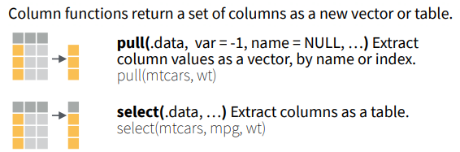
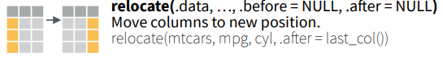
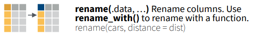
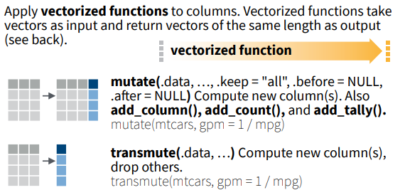

# **3. Manipulating Columns**

| Select columns | `select()`, `pull()`
| Arrange columns | `relocate()`
| Rename columns | `rename()`
| Add columns | `mutate()`, `transmute()`

Follow along with the code in section (3) of the R script. We will walk through each function with the visual explanations from the dplyr cheat sheet.

## 3.1 Select columns with `select()` and `pull()`
**Goal:** Keep only the columns you need.



```r
# select() keeps the columns you name
hours_data <- sgvp |>
  select(id, province, age_group, gender, volunteer_hours)

# A minus sign removes columns instead
no_donations <- sgvp |>
  select(-donor, -donation_amount)

# pull() takes a single column out as a vector (a list of values) rather than
# a data frame. This is handy when a function needs plain values, like mean().
hours <- sgvp |>
  pull(volunteer_hours)

mean(hours, na.rm = TRUE)
```

**What changed:** `select()` returns a data frame with fewer columns. `pull()` returns the values of one column on their own.

## 3.2 Arrange columns with `relocate()`
**Goal:** Change the order of the columns.



```r
# relocate() moves columns. By default it moves them to the front.
hours_first <- sgvp |>
  relocate(volunteer_hours)

# .after (or .before) says where to put them
hours_after_id <- sgvp |>
  relocate(volunteer_hours, .after = id)
```

**What changed:** Only the column order changes. The rows and values stay the same.

## 3.3 Rename columns with `rename()`
Goal: Give a column a new name.



```r
# rename() changes column names: new name on the left, old name on the right
sgvp_renamed <- sgvp |>
  rename(hours = volunteer_hours)
```

**What changed:** Only the column name changes. The data inside the column does not.

## 3.4 Add columns with `mutate()` and `transmute()`
**Goal:** Create new columns from existing ones.



```r
# mutate() adds a new column and keeps all the existing ones
# Convert yearly hours to hours per week
sgvp_weekly <- sgvp |>
  mutate(hours_per_week = volunteer_hours / 52)

# transmute() adds new columns and drops everything else
weekly_only <- sgvp |>
  transmute(id, hours_per_week = volunteer_hours / 52)
```

**What changed:** `mutate()` adds new columns while keeping existing ones. `transmute()` keeps only the columns you list.

<div markdown="1" style="border-left: 5px solid #7253ed; background-color: #f5f2ff; padding: 10px 20px; margin: 25px 0;">
**Practice**

Add a column called `dedicated` that is `TRUE` for people who volunteered more than 500 hours, and `FALSE` otherwise.

<details>
<summary><u>Click here for solution</u></summary>
<pre>
sgvp_dedicated <- sgvp |>
  mutate(dedicated = volunteer_hours > 500)

# Non-volunteers get NA rather than FALSE, because their hours are NA.
</pre>
</details>
</div>

### Useful functions inside `mutate()`

`mutate()` works with "vectorized" functions: functions that take a column and return one new value for every row. Some useful ones:

```r
# if_else(): one of two values, depending on a condition
sgvp_dedicated <- sgvp |>
  mutate(dedicated = if_else(volunteer_hours > 500, "Dedicated", "Other"))

# case_when(): more than two categories. Conditions are checked in order,
# and each row gets the value of the first condition that is TRUE.
# .default is used for rows where none of the conditions are TRUE.
sgvp_level <- sgvp |>
  mutate(volunteer_level = case_when(
    volunteer_hours > 500  ~ "High",
    volunteer_hours > 100  ~ "Medium",
    volunteer_hours <= 100 ~ "Low",
    .default = "Not a volunteer"
  ))

# between(): TRUE if a value is within a range (including both ends)
sgvp_mid <- sgvp |>
  mutate(mid_range = between(volunteer_hours, 100, 500))

# min_rank(): ranks each row. Use desc() so the most hours gets rank 1.
sgvp_ranked <- sgvp |>
  mutate(hours_rank = min_rank(desc(volunteer_hours)))

# .after (or .before) puts the new column where you want it
sgvp_ranked <- sgvp |>
  mutate(hours_rank = min_rank(desc(volunteer_hours)), .after = id)
```

See the "Vectorized Functions" section on the back of the dplyr cheat sheet for more.
&nbsp;    
&nbsp;