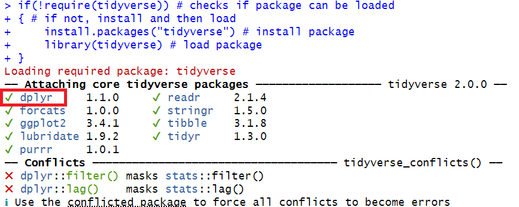
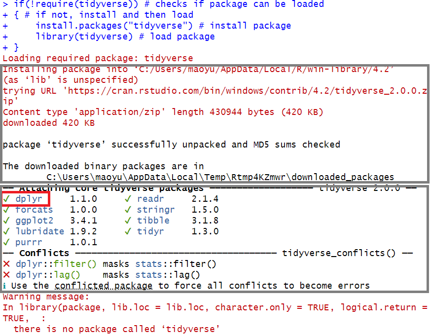
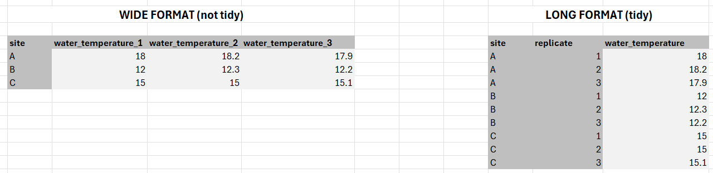

# **1. Introduction to dplyr**

## 1.1 What is *dplyr*?

A part of the tidyverse meta-package that facilitates data manipulation.
As with all other tidyverse packages, dplyr has <a href="https://dplyr.tidyverse.org/" target="_blank">extensive documentation</a> and <a href="https://www.rstudio.com/wp-content/uploads/2015/02/data-wrangling-cheatsheet.pdf" target="_blank">cheat sheets</a> available.


## 1.2 Set up

### Download the data

In this workshop we will use the 2023 Survey on Giving, Volunteering and Participating (SGVP) from Statistics Canada. The survey asked about 27,000 people across Canada about their volunteering and charitable giving. Our question for today is:

**Who are Canada's most dedicated volunteers?**

Download these two files and save them in the **same** folder:

- <a href="{{ '/files/sgvp_2023_workshop.csv' | relative_url }}" download>Download the data (sgvp_2023_workshop.csv)</a>
- <a href="{{ '/files/Data_Manipulation_Script.R' | relative_url }}" download>Download the R script (Data_Manipulation_Script.R)</a>

Open the R script in RStudio. Then go to **Session > Set Working Directory > To Source File Location**. This tells R to look for data in the same folder where the script is saved.

### Install and load the package

In order to be able to use the functions from the `dplyr` package, let's (install and) load it first.

```r
if(!require(tidyverse)) # checks if package can be loaded
  { # if not, install and then load
  install.packages("tidyverse") # install package
  library(tidyverse) # load package 
  }
```

<details>
	<summary><u>Click here for outputs</u></summary>
	<div style="border: thin grey 1px; background-color: #eeebee; padding:15px;">
		<p>If package already installed and can be loaded:</p>
	    
	    <br/>
	    <p>If package not installed:</p>
	    
    </div>
</details>

### Read in the data

```r
sgvp <- read_csv("sgvp_2023_workshop.csv")
```

Each row is one person who answered the survey. The columns include their province, age group, gender, whether they volunteered and for how many hours, and whether they donated and how much.


## 1.3 Tidy data

Tidy data is data that has been cleaned AND that is in the correct format for data analysis. Usually, it is best to have the data in a "long format" because of how code has to be written for data analysis.

<div style="margin-left: 5%; margin-top: 20px; margin-bottom: 20px">

</div>

Our survey data is already tidy: each variable is in its own column and each observation (one person) is in its own row.


## 1.4 Pipes

The pipe operator `|>` takes the result on its left side and passes it to the function on its right side. You can read it as "and then".

The use of the pipe operator is based on some patterns shared by most of the functions from the dplyr package:
* The input is a data frame, which is usually the first argument for a function.
* The output is also a data frame.  

Therefore, you can pass on the output from a function as input for the next function.

Most data manipulation tasks need several steps. For example, to keep only people living in British Columbia, and then keep only the columns we need:

```r
# without using pipes - operations are nested
sgvp_bc <- select(filter(sgvp, province == "British Columbia"), age_group, gender, volunteer, weight)

# with pipes - easier to read because each command is separated and in order
sgvp_bc <- sgvp |>
  filter(province == "British Columbia") |>
  select(age_group, gender, volunteer, weight)
```

