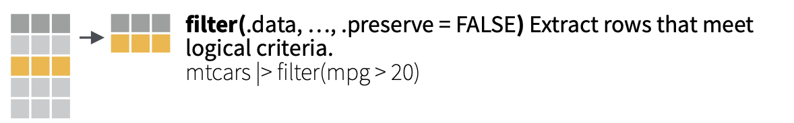
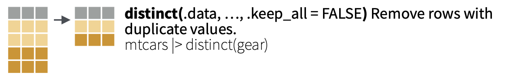
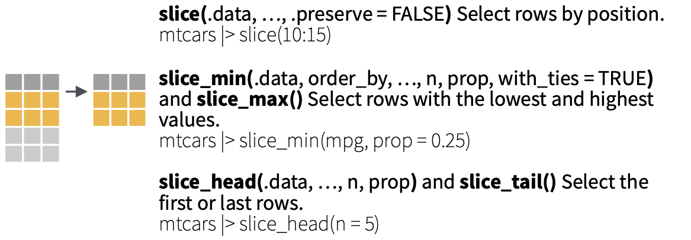
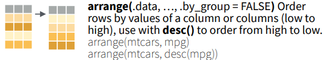
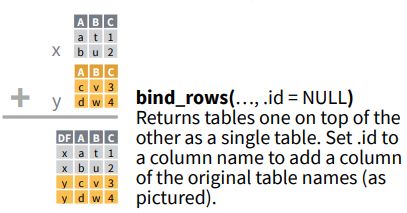

# **2. Manipulating Rows**

| Select rows | `filter()`, `distinct()`, `slice()` 
| Arrange rows | `arrange()`
| Combine rows | `bind_rows()`

Follow along with the code in section (2) of the R script. We will walk through each function with the visual explanations from the dplyr cheat sheet.

## 2.1 Filter rows with `filter()`
**Goal:** Keep only the rows that meet a condition.


```r
# Keep only the people who volunteered
volunteers <- sgvp |>
  filter(volunteer == "Volunteer")

# Keep people who volunteered more than 500 hours in the past year
dedicated <- sgvp |>
  filter(volunteer_hours > 500)
```

Useful comparison operators:

| `==` equal to | `!=` not equal to
| `>` greater than | `<` less than
| `>=` greater than or equal | `<=` less than or equal

Non-volunteers have `NA` for `volunteer_hours`. `filter()` drops any row where the condition can't be checked, so they are removed automatically.

You can combine conditions:

```r
# A comma (or &) means AND: both conditions must be true
dedicated_bc <- sgvp |>
  filter(volunteer_hours > 500, province == "British Columbia")

# | means OR: at least one condition must be true
west_coast <- sgvp |>
  filter(province == "British Columbia" | province == "Alberta")

# %in% is a shortcut for several ORs on the same column
prairies <- sgvp |>
  filter(province %in% c("Manitoba", "Saskatchewan", "Alberta"))
```

**What changed:** You now have a smaller data frame that keeps only rows matching the condition.

<div markdown="1" style="border-left: 5px solid #7253ed; background-color: #f5f2ff; padding: 10px 20px; margin: 25px 0;">
**Practice**

Keep volunteers aged 15 to 24 who volunteered more than 200 hours.

<details>
<summary><u>Click here for solution</u></summary>
<pre>
young_dedicated <- sgvp |>
  filter(age_group == "15 to 24 years", volunteer_hours > 200)
</pre>
</details>
</div>

## 2.2 Keep unique rows with `distinct()`
**Goal:** See the unique values in a column. This is a quick way to see what categories a column contains.



```r
age_groups <- sgvp |>
  distinct(age_group)

# With more than one column, distinct() keeps each unique COMBINATION
age_gender <- sgvp |>
  distinct(age_group, gender)
```

**What changed:** Duplicate values are removed, so each value (or combination) appears once.

<div markdown="1" style="border-left: 5px solid #7253ed; background-color: #f5f2ff; padding: 10px 20px; margin: 25px 0;">
**Practice**

What education levels are in the data? How many are there?

<details>
<summary><u>Click here for solution</u></summary>
<pre>
education_levels <- sgvp |>
  distinct(education)

# There are 5, including "Not stated"
</pre>
</details>
</div>

## 2.3 Pick specific rows with `slice()` and helpers
**Goal:** Select rows by position, or by the largest or smallest values.



```r
# slice() keeps rows by their POSITION (row number)
rows_10_15 <- sgvp |>
  slice(10:15)

# slice_max() keeps the rows with the largest values
# The 10 people who volunteered the most hours:
top_volunteers <- sgvp |>
  slice_max(volunteer_hours, n = 10)
```

**What changed:** `slice()` selects rows by position. `slice_max()` and `slice_min()` select rows with the largest or smallest values of a column.

<div markdown="1" style="border-left: 5px solid #7253ed; background-color: #f5f2ff; padding: 10px 20px; margin: 25px 0;">
**Practice**

Find the 10 people who donated the most money (`donation_amount`).

<details>
<summary><u>Click here for solution</u></summary>
<pre>
top_donors <- sgvp |>
  slice_max(donation_amount, n = 10)
</pre>
</details>
</div>

## 2.4 Reorder rows with `arrange()`
**Goal:** Sort rows by one or more columns.



```r
# arrange() sorts rows by a column, smallest to largest
by_hours <- sgvp |>
  arrange(volunteer_hours)

# desc() sorts from largest to smallest. Here we sort by province, then by
# hours (largest first) within each province.
by_province_hours <- sgvp |>
  arrange(province, desc(volunteer_hours))
```

**What changed:** The same rows are kept, but their order changes.

<div markdown="1" style="border-left: 5px solid #7253ed; background-color: #f5f2ff; padding: 10px 20px; margin: 25px 0;">
**Practice**

Sort the data by `donation_amount`, largest first.

<details>
<summary><u>Click here for solution</u></summary>
<pre>
by_donation <- sgvp |>
  arrange(desc(donation_amount))
</pre>
</details>
</div>

## 2.5 Combine rows with `bind_rows()`
**Goal:** Stack data frames on top of each other.



```r
# Top 5 volunteers in BC and in Ontario
top_bc <- sgvp |>
  filter(province == "British Columbia") |>
  slice_max(volunteer_hours, n = 5)

top_on <- sgvp |>
  filter(province == "Ontario") |>
  slice_max(volunteer_hours, n = 5)

top_bc_on <- bind_rows(top_bc, top_on)
```

**What changed:** `bind_rows()` stacks the data frames, matching columns by name. If one data frame has a column the other doesn't, the missing values are filled with `NA`.

<div markdown="1" style="border-left: 5px solid #7253ed; background-color: #f5f2ff; padding: 10px 20px; margin: 25px 0;">
**Practice**

Add the top 5 volunteers from Quebec to `top_bc_on`.

<details>
<summary><u>Click here for solution</u></summary>
<pre>
top_qc <- sgvp |>
  filter(province == "Quebec") |>
  slice_max(volunteer_hours, n = 5)

top_bc_on_qc <- bind_rows(top_bc_on, top_qc)
</pre>
</details>
</div>
&nbsp;    
&nbsp;
